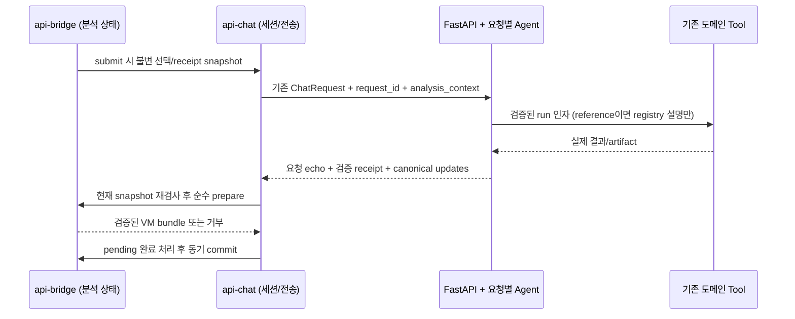

# K-EMS 콘솔 분석 문맥·검증 결과 계약 v1 — PH4-02A

상태: **설계 제안 / 리뷰 대상**. Issue [#14](https://github.com/GangHyeokLee/ai-ems-agent/issues/14).
조사일: 2026-11-04 (Asia/Seoul). 기능 조사 기준: `c604ff1e77279998e2b3b0d3ba3f10c0d21d0f6f`.
PH4-02A는 이 문서와 [인수 테스트 계약](contracts/console-analysis-context-v1-cases.json), STATE만 작성한다.
아래 API·결과 저장소·Tool 변경은 **현재 구현되어 있지 않다**. PH4-02B/C에서 구현·검증한다.

## 1. 현재 구조와 재사용 경계

| 현재 위치 | 조사 결과와 재사용 대상 |
|---|---|
| `ui/console/api-chat.js` | 계통별 세션·대화·초안, pending 객체 동일성, 응답 grid/session 확인, 60초 제한, 취소/오류 시 세션 교체. 현재 요청은 `session_id/message/grid_id`뿐이며 `ui_updates`는 무시 |
| `ui/console/api-bridge.js` | view 객체·선택 계통·map, `analysis.line/monitored/seq/sensSeq`, 수동 분석 요청·취소·현재 요청 검사·결과 commit을 소유 |
| `ui/console/api-analysis.js` | 계통별 URL·capability·응답→VM 검증·패널·overlay 생성. fetch/물리계산을 수행하지 않음 |
| `web_app.py:ChatRequest/grid_chat/chat/mongolia_chat` | URL/body grid 일치 검사, KPG/MN 별도 메모리 이력, 기존 `/api/chat`과 grid chat. request/view 식별자·세션 동시 실행 잠금은 없음 |
| `agent/graph.py`, `agent/tools.py` | KPG LangGraph→ToolNode, 기존 도메인 함수와 결정적 포매터. graph는 network를 closure로 보유하며 KPG Tool은 현재 주로 content dict를 반환 |
| `agent/mongolia_graph.py`, `mongolia_tools.py` | PF 5개·분석 2개, 미지원 Tool 차단. 분석 Tool은 `content_and_artifact`; `_mongolia_analysis_evidence`가 호출 ID·이름·계통·사고와 오류를 검증 |
| `ui/index.html:sendChatMessage` | 원 요청 grid·`gridSwitchToken`, MN update/result grid와 capability 확인 후 기존 카드/지도 어댑터 적용. 대화 복원으로 과거 overlay를 재실행하지 않음 |

현재 코드를 그대로 신뢰 경계로 사용할 수 없는 부분:

- KPG `line_contingency` content는 대표 위반 1개로 축약된다. `_agent_security_result_for_ui`의 위반 수가
  목록 길이보다 클 수 있어 콘솔의 전체 응답 검증과 직접 호환되지 않는다. **같은 계산의 전체 raw 결과를
  artifact에 보존**해야 하며, 축약 결과를 메우거나 숨겨진 재계산으로 보완하지 않는다.
- KPG `_extract_ui_updates`는 ToolMessage content/name을 읽는 기존 변환기다. 새 프로토콜의 실제 실행·artifact
  검증기를 대체하지 않는다. `_sensitivity_result_for_ui`도 성공 이외의 상태를 먼저 검증한 뒤 사용해야 한다.
- KPG 자동 감시는 수동 API에서 `NO_OVERLOAD`를 반환하지만 기존 Agent Tool은 ValueError를 발생시킨다.
  B에서 실제 target 선택/판정 로직을 공용 helper로 추출하고 v1에 명시적인 미평가로 연결한다.
  legacy Tool의 기존 오류 계약은 유지하며 오류 문구만 보고 가짜 canonical 결과를 만들지 않는다.
- MN의 `다시 계산/재계산` 일반 차단은 선로 분석 재실행과 충돌할 수 있다. v1의 명시적 선로 operation에만
  맞춰 판별하고 발전기/부하/출력 변경·OPF·Redispatch 등의 기존 차단은 유지한다. legacy 경로는 보존한다.
- 기존 수동 GET 응답에는 서버가 다시 찾을 결과 ID가 없다. 클라이언트의 VM/수치/해시를 보내는 방식으로
  이 공백을 채우지 않는다. 아래 opt-in 결과 receipt가 필요하다.

기존 화면과 콘솔의 DOM·세션 취소 정책은 각각 유지한다. 서버 계산·결과 변환·근거 검증만 재사용한다.
`app.js/models.js/app.css`, 전기적 모델·데이터·과거 검증 해시는 이 작업의 변경 대상이 아니다.

## 2. 결정: 기본 채팅, 결과 참조, 실제 재실행

| 경로 | 의미 | Agent/물리해석 | 화면 업데이트 |
|---|---|---|---|
| 문맥 없는 기존 ChatRequest | PH4-01/기존 화면의 기본 채팅 | 기존 동작 유지 | 콘솔은 기존처럼 update 미적용 |
| `mode=reference` | 서버에 남은 결과를 설명 | 새 LLM/Tool/계산 없이 검증된 결과의 결정적 요약 반환 | `ui_updates=[]`; 기존 지도 유지 |
| `mode=run` | 명시한 선로 분석을 실제 다시 실행 | 기존 Agent/Tool의 실제 호출·결과 확인 | 허용된 새 결과 bundle만 적용 |

콘솔에 ‘기본 채팅 / 기존 결과 설명 / 새 분석 실행’을 명시한다. 새로운 분석 모드는
`operation=security | sensitivity | security_then_sensitivity`를 사용한다. 자유서술로 모드를 추측·승격하지 않는다.
기존 결과가 없거나 만료됐다는 이유로 reference를 run으로 자동 전환하지 않는다.

## 3. 기능 협상과 기존 ChatRequest 호환성

- 기존 `POST /api/chat`(KPG) 및 `POST /api/grids/{grid_id}/chat`을 유지한다.
- `request_id: str | null = null`, `analysis_context: object | null = null`만 선택적으로 추가한다.
  둘 다 없거나 null이면 기존 요청/응답 경로다. 기존 exact-key 응답 테스트를 유지하며 새 null 필드를 넣지 않는다.
  둘 중 하나만 있으면 422다. 기존 화면은 수정하지 않아도 동작한다.
- grid catalog에 `console_analysis_context_versions: [1]`을 추가한다. 실제 서버 검증 경로가 준비되고
  해당 계통의 분석이 가능한 경우에만 광고한다. 필드 없음/빈 배열이면 콘솔의 새 분석 모드를 비활성화한다.
- 새 서버인지 확인하지 않고 opt-in 요청을 보내지 않는다. 구 서버의 Pydantic이 미지 필드를 무시해
  reference 요청을 일반 Agent 실행으로 처리할 수 있기 때문이다. 요청 후에도 v1 응답 acknowledgment를 요구한다.
  실패 시 문맥을 제거해 자동 재전송하지 않는다.

### 요청 예시: MN 선로 분석 재실행

다음은 **계약 예시이며 계산 증거가 아니다**. 기본 채팅의 3개 필드는 그대로다.

```json
{
  "session_id": "console-example-mn",
  "message": "선택한 선로의 N-1과 후속 민감도를 실행해 줘.",
  "grid_id": "mn-osm-35k",
  "request_id": "10000000-0000-4000-8000-000000000001",
  "analysis_context": {
    "version": 1,
    "view_id": "20000000-0000-4000-8000-000000000001",
    "revision": 7,
    "mode": "run",
    "operation": "security_then_sensitivity",
    "outage_line_id": "751261406-1_0",
    "monitored_line_id": null,
    "references": {"security": null, "sensitivity": null}
  }
}
```

### v1 요청 제약

| 필드 | 규칙 |
|---|---|
| URL/body `grid_id` | 기존 일치 검사 유지. 본문 생략은 URL grid를 사용하며 KPG 기본값이 MN으로 섞이지 않게 처리 |
| `session_id` | v1은 기존 콘솔 형식을 허용하는 1~128자 ASCII 식별자(`[A-Za-z0-9_-]`); legacy 제한을 소급 변경하지 않음 |
| `message` | v1은 공백만인 문자열 거부, 최대 8000자. 사용자 문장은 계산 결과/권한 근거가 아님 |
| `request_id`, `view_id` | 표준 소문자 UUID v4. request는 매 전송, view는 매 openView/reload마다 새 값 |
| `version`, `revision` | version은 정수 1. revision은 boolean/string/float가 아닌 정수 0~`2^53-1` |
| 선로 ID | 사고 ID 필수, 1~128자·주변 공백 없음. 감시 ID null은 **도메인 자동 선택**이며 미지 ID/사고와 같은 ID는 거부 |
| `references` | 위 두 key만 허용. run은 모두 null. reference는 operation이 요구하는 종류의 서버 result ID가 있어야 함 |
| 기타 필드 | 중첩 문맥은 extra 금지. `result/values/verified/candidates` 등 클라이언트 수치를 받지 않음 |

`reference`의 security/sensitivity operation에는 해당 종류 ID만, chain에는 두 ID가 필요하다.
receipt의 실제 사고·감시·모델과 요청 조건을 다시 비교한다. 자동 감시(null)라면 서버가 선택했던 실제 ID를
설명하고, 명시적 감시 ID라면 정확한 일치를 요구한다. v1 콘솔의 민감도 top_n은 기존 기본 5로 고정한다.
새 top_n 옵션이나 파일 경로·전기정수 입력을 추가하지 않는다.

## 4. 수동 분석 결과 receipt: 숫자를 클라이언트에서 역수입하지 않기

기존 GET 경로와 물리 응답은 재사용한다.

| 계통 | Security | Sensitivity |
|---|---|---|
| KPG | `/api/security-analysis` | `/api/sensitivity-analysis` |
| MN | `/api/grids/mn-osm-35k/security-analysis` | `/api/grids/mn-osm-35k/sensitivity-analysis` |

콘솔이 다음 헤더를 **모두** 보낼 때만 결과 등록을 opt-in한다. 일부만 있으면 422다.

```text
X-EMS-Analysis-Context-Version: 1
X-EMS-Session-ID: console-example-mn
X-EMS-Request-ID: 30000000-0000-4000-8000-000000000001
```

기존 query parameter와 flat 결과를 유지하고, 계산·검증을 마친 응답에만 `analysis_receipt`를 추가한다.
헤더 없는 호출의 응답 shape는 바꾸지 않는다. opt-in은 `Cache-Control: no-store`로 반환한다.
세션 ID를 query/URL에 넣지 않으며 custom header 추가는 same-origin 콘솔 범위다.

`AnalysisReceipt` 필드:

- `result_id`: 서버 UUID v4. 원본 결과는 서버에 저장하며 ID 자체가 인증을 뜻하지 않는다.
- `grid_id`, `kind`(`security|sensitivity`), `outage_line_id`, 실제 `monitored_line_id`, `top_n`.
  Security의 monitored/top_n은 null, Sensitivity 완료 시 실제 감시 ID와 top_n=5를 기록한다.
- `model_revision`: **실제로 계산한 로드 모델·설정**의 서버 fingerprint. 현재 파일 이름/mtime이나 클라이언트 해시로 대체하지 않는다.
- `producer`(`manual|agent_tool`), `producer_request_id`, `tool_call_id`(manual은 null), `assessment`(`completed|not_evaluated`).
- `created_at`, `expires_at`: 서버 UTC RFC3339 시각. 클라이언트 시각을 검증 근거로 사용하지 않는다.

서버 저장 항목은 receipt + owner `(grid_id, session_id)` + canonical 결과 + 실행 근거다.
일반 dict/명시적 잠금으로 **프로세스당 최대 256개, 10분 TTL**을 둔다. 용량 초과는 오래된 완료 항목부터 제거한다.
같은 모델이라도 다른 owner/grid/kind/사고/명시적 감시/parameter의 ID는 재사용할 수 없다.
누락·만료·재시작·owner 불일치는 409 `ANALYSIS_REFERENCE_UNAVAILABLE`, 모델 변경은 409 `ANALYSIS_REFERENCE_STALE`로 거부한다.
실패한 계산은 신뢰 가능한 결과로 등록하지 않는다. 실제 도메인이 반환한 미평가 상태는 후보/성공 판정 없이 별도 등록할 수 있다.

KPG fingerprint는 로드한 case·기준 운전점/variant·LF 설정·변환 규약을, MN은 검증된 모델/번들·시나리오·설정·자체검증을 식별한다.
현재 상태와 실제 로드 모델을 일치시킬 수 없으면 receipt를 발급하지 않는다. 검사 전후 모델 변경도 등록을 무효화한다.

## 5. v1 응답 계약과 신뢰 경계

v1 응답은 기존 `session_id/grid_id/answer/ui_updates` 및 MN의 기존 부가 필드를 유지하며 다음만 추가한다.

| 필드 | 의미 |
|---|---|
| `request_id` | 수신한 현재 요청 ID |
| `analysis_context` | 검증한 요청 snapshot 그대로 echo. 자동 선택된 실제 ID로 요청 null을 덮어쓰지 않음 |
| `analysis.status` | `referenced/completed/not_evaluated/not_run/failed` |
| `analysis.source` | `server_reference/tool_execution/none` |
| `analysis.results` | 서버 검증을 통과한 `AnalysisReceipt[]`; reference의 producer_request_id는 원래 계산 요청 ID |
| `analysis.message` | 새 실행/기존 설명/미평가/실패 구분 안내. 물리 수치는 서버 결과 포매터에서만 생성 |
| `analysis.reason_code` | 미평가/미실행 사유 코드 또는 null. 실행하지 않은 Sensitivity의 물리 결과를 대신 생성하는 필드가 아님 |

**예시: 모델이 필요한 Tool을 실제 호출하지 않은 경우** — HTTP 200이어도 실행 성공이 아니다.

```json
{
  "session_id": "console-example-mn",
  "grid_id": "mn-osm-35k",
  "request_id": "10000000-0000-4000-8000-000000000001",
  "analysis_context": {
    "version": 1, "view_id": "20000000-0000-4000-8000-000000000001", "revision": 7,
    "mode": "run", "operation": "security_then_sensitivity",
    "outage_line_id": "751261406-1_0", "monitored_line_id": null,
    "references": {"security": null, "sensitivity": null}
  },
  "answer": "검증된 분석 Tool 실행 결과가 없어 새 계산 성공을 확인할 수 없습니다.",
  "ui_updates": [],
  "analysis": {"status": "not_run", "source": "none", "results": [], "reason_code": "TOOL_NOT_EXECUTED", "message": "실제 분석 결과 없음"}
}
```

run 성공의 update는 `{type, grid_id, result_id, result}`다. type은 security/sensitivity만 허용한다.
result는 같은 계산에서 얻은 **계통별 기존 REST canonical payload**이며 receipt와 analysis.results가 대응해야 한다.
KPG full violation·기존 ID→모선 변환, MN 원본 ID·단위·자체검증/분리 정보를 보존한다.
generator_contingency·Redispatch 등은 이 버전의 update 허용 목록 밖이다. 기본 채팅의 기존 KPG 기능은 그대로다.

### 실제 실행을 입증하는 서버 경로

1. 요청·capability·모델·references를 검증하고 불변 server job을 만든다. 모델에 raw client context를 SystemMessage로 넣지 않는다.
2. run은 기존 graph/tool factory에 **요청별 closure**로 검증 문맥·실행 ledger를 전달한다.
   singleton graph/tool/global prompt를 요청마다 덮어쓰지 않는다. KPG에 model 주입을 추가하고 MN의 기존 model 주입을 재사용한다.
3. 모델에는 검증한 ID·operation만 일시적인 문맥으로 제공한다. 이 문맥을 영구 messages에 누적하지 않는다.
   ToolNode 직전 guard가 허용 Tool·순서·인자와 frozen outage/명시적 monitored를 확인한다.
   자동 감시 요청에서 모델이 임의 감시 ID를 정하거나 top_n을 5 외 값으로 바꾸면 실행 전에 거부한다.
   v1은 한 AI turn에 분석 Tool 한 개만 허용한다. 여러 분석 호출이 한 turn에 있으면 모두 실행 전에 거부한다.
   chain은 실제 N-1 결과를 받은 다음 turn에 Sensitivity를 호출하며 ToolNode의 병렬 실행에 순서를 맡기지 않는다.
4. 기존 도메인 호출의 raw 결과를 ledger와 artifact에 남긴다. KPG도 content 요약은 유지하고 full artifact를 추가한다.
   직접 Tool 호출의 기존 반환·LLM 노출 스키마는 회귀로 확인한다. 잘린 content로 전체 결과를 재구성하지 않는다.
5. AIMessage의 호출 ID/이름/검증된 인자 ↔ ToolMessage ID/이름/status ↔ 해당 job의 실제 실행 ledger/artifact를 연결한다.
   MN의 기존 검증 규칙을 재사용·보강한다. 이름/`verified:true`/LLM 문장만 일치하는 결과는 거부한다.
6. canonical payload를 검증하고 현재 모델 fingerprint를 다시 확인한 뒤 receipt와 응답을 publish한다.
   reference는 registry의 결과만 결정적으로 설명하며 새 ToolMessage나 새 실행 receipt를 꾸미지 않는다.

v1의 계산 수치·성공/안전 판정은 서버 포매터가 검증된 canonical 결과로 만든다. 모델의 자유서술은 표시용 계산 근거가 아니다.
실패/Tool 누락 뒤 모델이 “성공”이라고 답해도 v1 analysis 답변은 고정 안내로 대체한다.
Tool 실패가 있는 chain은 부분 성공 bundle을 현재 지도에 적용하지 않는다. 전부 검증 후 publish하거나 updates=[]로 반환한다.
비수렴·분리·`NO_OVERLOAD`는 검증된 **미평가 결과**로 표시하며 성공/순위와 구분한다.
기존 서비스가 실제로 반환한 미평가 payload만 사용한다. 수행하지 않은 Sensitivity의 결과/receipt를 만들어 내지 않는다.
chain의 검증된 N-1이 비수렴 또는 MN 분리를 확인하면 `not_evaluated`로 정상 종료할 수 있다.
실제 N-1 receipt/update만 반환하고 reason_code로 Sensitivity 미실행을 알린다. 이는 Tool 실패에 따른 부분 성공과 다르다.
실제 Sensitivity Tool이 미평가를 반환한 경우에만 그 canonical payload/receipt도 포함한다.

## 6. 콘솔 snapshot과 결과 적용



### 상태 소유권과 UI 연결

- bridge가 view UUID와 `analysisRevision`을 소유한다. 전송 시 chat의 콜백 `captureAnalysisContext()`로
  scalar ID·revision·receipt ID만 복사·freeze한다. VM/Set/Map·DOM·수치 전체는 전송하지 않는다.
- 사고 선택과 실제 결과의 `analysis.line`은 구분한다. 새 `selectedOutageLineId`는 수동 N-1 시작 또는
  카드의 명시적인 ‘사고 선로로 선택’으로만 갱신한다. 단순 후보/모선/지도 선택으로 사고 문맥을 바꾸지 않는다.
- 감시는 기존 `analysis.monitored`의 명시 ID/자동(null)을 사용한다. UI 문맥 표시와 실제 요청 snapshot을 일치시킨다.
- chat은 `getSessionId(gridId)`, `invalidateAnalysisContext()`를 최소 노출하고 bridge가 수동 요청의 receipt 헤더에 사용한다.
  수동 분석 시작/선로 변경으로 revision을 바꿀 때 먼저 진행 중 chat을 취소·세션 교체한 뒤 새 session ID를 캡처한다.
- reference/run은 수동 분석 loading 중 비활성화한다. 문맥 없는 기본 채팅과 분석 패널의 공존은 유지한다.

revision은 선택 사고/감시·분석 모드/operation 변경, 새 수동 요청 시작·결과 commit, 초기화, 새 chat 결과 commit에서 증가한다.
view 재생성은 view_id도 바꾼다. 메시지·초안·패널 접힘/펼침·지도 zoom 같은 표시 변경만으로는 증가시키지 않는다.

### 폐기 규칙과 원자적 commit

응답은 active API grid, view 객체/UUID, analysisRevision, session_id, request_id, pending 객체,
요청 context echo와 일치해야 한다. Abort 성공 여부와 무관하게 검사하며 불일치 시 v1 답변과 updates 모두 폐기한다.

`prepareChatAnalysisUpdates`는 순수 검증이다. 각 update/receipt/현재 모델·capability·요청 ID·사고·감시를 확인하고,
기존 `KemsApiAnalysis.security/sensitivity(..., analysisCtx(view))`로 VM을 임시 생성한다.
chain은 Security→Sensitivity 순서로 같은 사고를 검증한다. 알 수 없는 타입/중복 종류/잘못된 참조/NaN/잘못된 count는 bundle 전체 거부다.
현재 지도에 없는 설비를 추측해 그리지 않는다. 기존 어댑터의 ‘검증된 설비지만 지도 매핑 없음’ 표시는 유지한다.

모든 검증 후 **await 없이** 재검사→chat pending 완료/답변 반영→bridge commit을 수행한다.
commit은 이전 수동 controller를 취소하고 seq/sensSeq를 올려 지연 결과를 무효화한 뒤 VM·receipt·revision을 함께 바꾸고
기존 paint/render/refresh 경로를 호출한다. 자기 응답의 revision 증가 때문에 자기 세션을 retire하지 않도록 pending을 먼저 완료한다.
DOM을 부분 갱신한 뒤 검증하지 않는다. reference 응답은 분석 상태/overlay/revision을 변경하지 않는다.

N-1만 반영할 때 이전 Sensitivity는 비운다. 같은 사고의 Sensitivity만 새로 반영할 때는 model_revision이 같은
기존 Security와의 대응 또는 같은 응답의 Security가 필요하다. 대응하지 않으면 적용을 거부한다.
따라서 콘솔의 Sensitivity 단독 실행은 대응하는 N-1 receipt가 있을 때만 허용하고 없으면 chain 선택을 안내한다.
chain이 분리/비수렴으로 종료되면 실제 평가 상태와 reason_code를 표시하고 과거 후보/marker를 제거한다.
Sensitivity가 실행되지 않았다면 ‘미실행/미평가’ 상태만 표시하며 VM·수치·receipt를 만들어 내지 않는다.

대화 reset은 지도·수동 VM을 유지하되 그 receipt의 이전 session 바인딩을 reference에 사용하지 못하게 한다.
진행 중 수동 응답의 VM은 기존 seq 검사를 통과하면 표시할 수 있지만 session이 달라졌으면 receipt는 채택하지 않는다.
만료/재시작/이전 세션의 결과 설명은 사용자가 새 실행을 선택하도록 안내한다. 자동 재계산·이전 owner receipt 재발급은 하지 않는다.
이력 복원은 텍스트만 복원하며 과거 updates를 다시 실행하지 않는다.

## 7. 서버 동시성·실패·운영 한계

- history read→graph invoke→history write는 grid/session 단위 non-blocking lock으로 보호한다.
  같은 세션의 별도 동시 요청은 409 `SESSION_BUSY`; KPG와 MN의 lock/history/ledger를 공유하지 않는다.
  legacy와 v1이 같은 세션에 접근할 때도 동일한 보호를 사용한다. 수동 receipt 계산은 history lock을 요구하지 않는다.
- `(grid, session, request_id)`와 정규화 입력 fingerprint로 10분 메모리 중복 창을 둔다.
  진행 중 재전송은 409 `REQUEST_IN_PROGRESS`, 완료 후 동일 입력은 같은 응답 재사용, 다른 입력이면 409 `REQUEST_ID_REUSE`다.
  클라이언트는 자동 재시도하지 않는다. 재시작/TTL·용량 제거 이후의 영구 exactly-once를 약속하지 않는다.
- registry/ledger의 짧은 자료구조 잠금과 엔진 실행 잠금은 분리한다. LLM 대기 중 전역 엔진 잠금을 잡지 않는다.
  KPG는 global network에 AC 결과가 쓰이므로 해당 network를 읽거나 바꾸는 기존 수동/API/Tool 경로를 동일한
  재진입 잠금 경계로 보호한다. MN의 검증 캐시 lock과 분석별 독립 network 로드는 유지한다.
  실제 network 접근 전 non-blocking 획득 실패는 409 `ANALYSIS_BUSY`; 기존 순차 호출의 수치/shape는 유지한다.
- HTTP 취소/60초 UI timeout은 동기 graph/JVM 실행 중단이 아니다. 실행 중인 이전 job의 잠금/ledger를 조기에 해제하지 않는다.
  새 UI 세션은 독립되며 뒤늦게 끝난 job은 새 대화/지도를 바꿀 수 없다. provider 전송 timeout·graph step 제한도 B에서 설정·검증한다.
- **단일 worker, 프로세스 메모리**가 지원 범위다. 재시작 시 receipt와 중복 창은 소실된다.
  worker 개수를 자동 감지한다고 주장하지 않는다. 단일 worker를 보장할 수 없으면 v1 capability를 광고하지 않는다.
  DB/Redis/작업 큐/영구 결과 저장/계정 인증은 추가하지 않는다. session_id는 인증·권한 부여 수단이 아니다.

| 상황 | v1 처리 |
|---|---|
| schema/부분 opt-in/잘못된 ID 문법 | 422, LLM·엔진 미호출 |
| URL/body grid 불일치·한국 OSM·비활성 capability | 409, Tool·LLM 미호출; unknown grid는 404 |
| receipt 없음/만료/owner·조건 불일치 | 409 `ANALYSIS_REFERENCE_UNAVAILABLE`, 재실행으로 fallback하지 않음 |
| 모델 revision 변화 | 409 `ANALYSIS_REFERENCE_STALE` 또는 503 모델 사용 불가, updates 없음 |
| Tool 오류/미허용 호출/검증 실패 | 오류를 성공으로 설명하지 않음, v1 updates=[]; 서버/연결 장애는 기존 KPG 500·MN 503 경계 유지 |
| Tool 없이 성공 문장만 반환 | `analysis.status=not_run`, source=none, results/updates=[] |
| 오래된/다른 계통/불일치 echo 응답 | 클라이언트가 대화·패널·지도에 반영하지 않음 |

v1 transport 오류의 detail은 `{code, message, request_id}`로 고정된 안내를 제공하고 인증/환경 경로·provider 원문을 노출하지 않는다.
legacy detail의 기존 string 계약은 유지한다. 프런트는 구 서버의 string 오류도 표시할 수 있어야 한다.

## 8. 계통별 capability와 해석 범위

| 계통 | 계약 적용 |
|---|---|
| KPG | chat + 해당 security/sensitivity capability 확인. full artifact와 canonical mapper 준비 전 v1 미광고. 기존 발전기/재급전 기본 채팅을 line-analysis update로 오인하지 않음 |
| MN | PF/chat, Security, Sensitivity를 각각 확인. PF-only 채팅은 유지. `NOT_EVALUATED_ISLANDING`/비수렴/자체검증 실패를 완료·후보 순위로 표시하지 않음 |
| 한국 OSM | v1 versions=[], chat/분석 controls 비활성. 직접 API 요청도 기존 409, 다른 계통으로 fallback 금지 |

KPG 합성 시험계통·MN 합성 시나리오의 기존 고지, 단위·부호·원본 ID·발전소 레코드/합성 발전기 구분을 유지한다.

## 9. B/C 변경 파일과 책임

| 파일(예정) | 역할 |
|---|---|
| `src/ai_ems/analysis_context.py` (신규) | v1 요청/receipt 모델, registry·job/중복/세션 잠금, 순수 근거 검증. 범용 에이전트 프레임워크를 만들지 않음 |
| `web_app.py` | optional ChatRequest 분기, 수동 receipt opt-in, canonical 결과 등록·v1 응답/오류. legacy helper는 재사용하고 새 검증을 우회하지 않음 |
| `src/ai_ems/agent/tools.py`, `graph.py` | KPG full artifact 보존, model/요청별 guard 주입, v1 허용 Tool·인자 통제. 전기적 도메인 알고리즘은 유지 |
| `src/ai_ems/agent/mongolia_tools.py`, `mongolia_graph.py` | 기존 실제 artifact/독립 service 재사용, 요청별 guard·문맥, v1 선로 재실행과 미지원 요청 분리 |
| `src/ai_ems/network.py`, 관련 network 접근 경로 | 공유 KPG 엔진 잠금 경계. 직접/중첩 Tool·수동 요청 격리 검증; domain 수치 규칙 변경 금지 |
| `src/ai_ems/grid_catalog.py` | v1 협상 필드. 준비되지 않은 grid/operation을 광고하지 않음 |
| `ui/console/api-chat.js` | 모드/operation·불변 snapshot, request ID/echo 검사, pending·세션 정책, 결과 콜백. 텍스트 렌더링 유지 |
| `ui/console/api-bridge.js` | 선택 문맥/revision/receipt 소유, 수동 opt-in, 전체 prepare→commit, 기존 상태·overlay 경로 재사용 |
| `ui/console/api-analysis.js`, `api-bridge.css` | 헤더/receipt 전달을 위한 최소 어댑터 확장, 출처·실행/참조·미평가 표시. 계산·fetch 책임을 섞지 않음 |
| 새 API/브라우저 테스트 + 기존 관련 테스트 | 아래 계약을 실제 서비스·지연 응답에 연결. 기존 assertions를 삭제/약화하지 않고 새 동작의 기대값만 명시적으로 확장 |
| 새 단계별 검증 문서/해시 기록, STATE | 필요한 before/after 연결을 새로 추가. Stage 1·3C·Phase 2·3·4 기록은 덮어쓰지 않음 |

`ui/index.html`은 데이터 흐름·변환 규약 재사용의 근거이며 DOM 통합/refactor 대상이 아니다.
실제 구현 중 파일 범위가 달라지면 이유와 계약 영향을 먼저 기록한다.

## 10. PH4-02B/C 구현·인수 순서

### B: 서버 계약과 신뢰 경계

1. B0: active model revision 획득·KPG 전체 결과 보존·공유 network 잠금 경계를 먼저 spike/리뷰한다.
   실제 로드 모델과 revision을 일치시킬 수 없거나 legacy 수치/shape가 바뀌면 v1을 광고하지 않고 중단한다.
2. optional schema·협상·수동 receipt·bounded registry·중복/세션 보호 구현. 참조는 실제 저장 결과만 설명한다.
3. 요청별 graph/guard·전체 artifact·canonical bundle·v1 고정 요약/오류 구현. 잘못된 입력에서 engine/model 호출 0을 검증한다.
4. scripted 모델 + 실제 KPG/MN Tool과 직접 REST/domain 결과 비교. legacy exact-key/Tool 직접 호출·모든 오류 회귀를 유지한다.

B 완료: JSON 계약의 B 항목 통과, 조작/교차 계통/만료/모델 변경/동시성 거부 확인, 기존 테스트 통과,
실제 실행 증거·미검증 사항 기록. 아직 콘솔에 새 지도 동작을 켜지 않는다.

### C: 콘솔 연결과 Chrome 인수

1. 협상 UI·선택 문맥·수동 receipt·불변 전송 snapshot 연결. 기본 채팅/legacy UI를 유지한다.
2. pure prepare→atomic commit, seq/revision·session invalidation, provenance/미평가 표시 구현.
3. 실제 FastAPI와 scripted graph/실제 Tool을 결합한 Chrome에서 요청 지연·순서 역전·Abort 무시를 검증한다.
   Phase 3·PH4-01 및 기존 `/` 회귀, 한국 호출 0, 초안·패널·overlay 보존, reset/TTL 시 자동 재실행 0을 확인한다.
4. 실제 LLM smoke는 별도 허용 범위에서 모델·질의·실제 Tool 근거·성공/실패를 기록한다. Mock 통과와 합산하지 않는다.

C 완료: JSON 계약의 C 항목과 기존 회귀 통과, 스크린샷/로그/실제 LLM 검증 구분, STATE·인수인계·Draft PR 갱신.
각 테스트·서버 기동·HTTP·Chrome에 명시적 제한을 적용하고 현재 작업 트리의 직접 변이는 금지한다.

## 11. 설계 리뷰에서 남은 확인

[B0 선행 검증](PH4-02B0_SERVER_PREFLIGHT.md)에서 실제 KPG 사본·격리 ToolNode 실험을 수행했다.
model revision과 잠금은 CONDITIONAL, 같은 실행의 full artifact 방식은 GO다. 프로덕션 기능은 미구현이다.
최초 AC의 상태 쓰기·재로드 caseDate 차이, Security/Sensitivity 유효 설정 차이,
ToolNode 실행 스레드의 잠금 소유권과 launcher의 worker 환경 영향을 B에서 먼저 해소해야 한다.
확인되지 않은 모델/접근 경계에서는 v1 capability를 광고하지 않는다.

- 프로토콜 형태는 이 제안으로 정했으나 **아직 승인·구현 전**이다. receipt 헤더/TTL·동기 실행 방식의 리뷰가 필요하다.
- B에서 B0의 KPG active network revision·접근 목록을 실제 guard에 연결하고 누락 없는지 통합 테스트해야 한다.
  이를 파일 mtime이나 LLM 설명으로 대신 통과시키지 않는다.
- 동기 JVM 실행을 강제 취소하는 기능은 없다. 긴 실제 모델/계산의 운영 timeout 값은 실제 환경 검증 후 기록한다.
- 단일 worker 전제와 기존 session_id의 비인증 성격, 재시작/만료 뒤 이전 화면의 참조 불가를 배포·UI에서 명시해야 한다.
- 실제 LLM의 자연어 선택 품질·설치/라이선스 승인 등 이전 검증의 미완료 사항은 본 설계 검증으로 해결되지 않는다.
